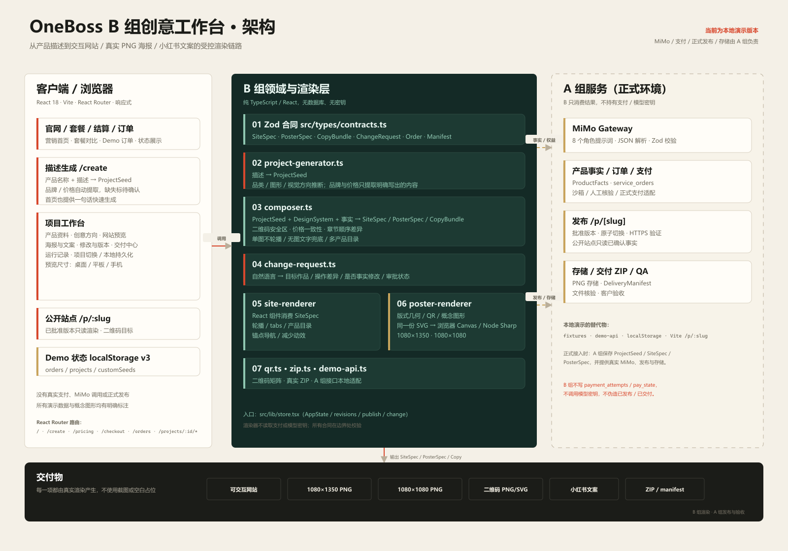
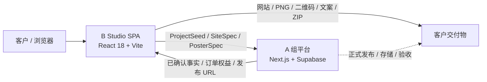
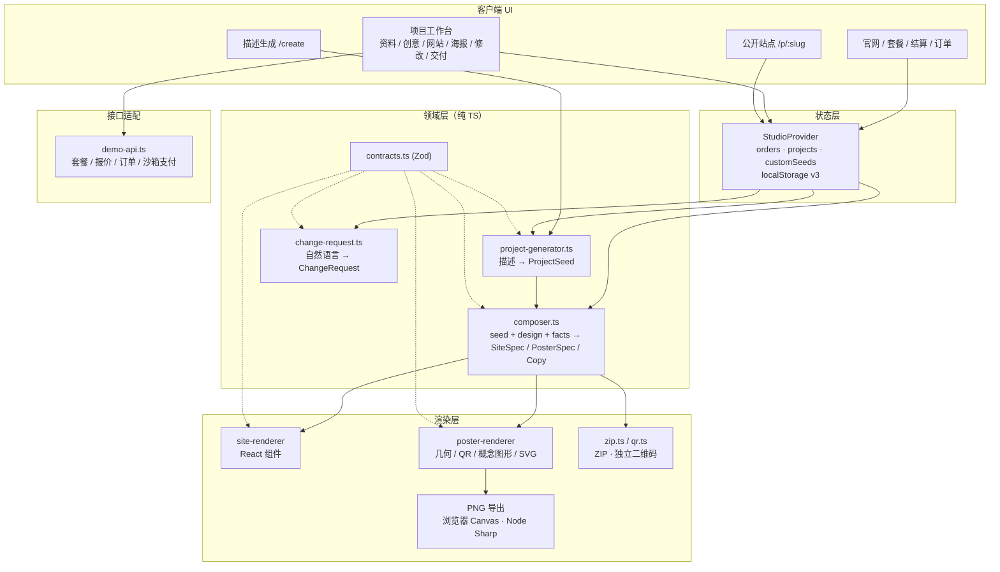
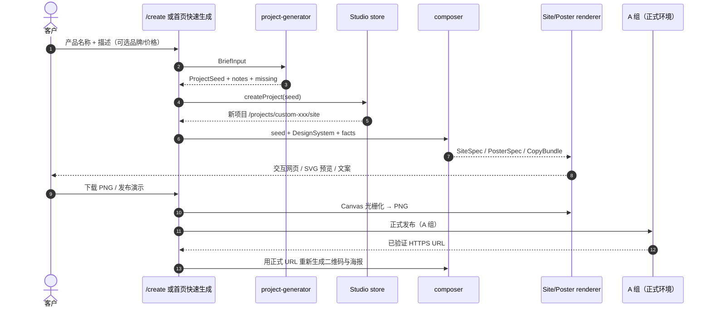
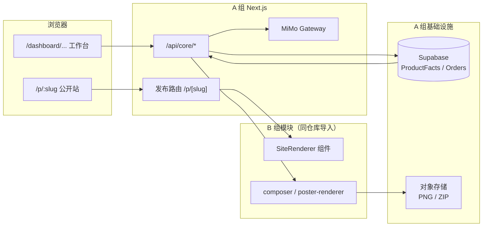

# B 组架构图

> 对应 `b-studio/`（当前分支 `feat/creative`）。  
> 一句话：浏览器里的 React 工作台负责“描述 → 项目 → 预览”，纯 TypeScript 领域层负责“项目 → 受控 SiteSpec / PosterSpec / 文案”，再分别渲染成真实网页、SVG/PNG 和 ZIP；真实 MiMo、支付、发布与存储由 A 组提供。

\n\n> 平台整体架构（A 组 Core + B 组 Studio + 集成缺口）见仓库根目录 [docs/OVERALL_ARCHITECTURE.md](../../docs/OVERALL_ARCHITECTURE.md)。

## 1. 系统上下文



- **B 组拥有**：页面与工作台、描述生成器、`SiteSpec` / `PosterSpec` 组合器、网站渲染器、海报 SVG/PNG 渲染、二维码安全区、文案、修改范围解析、演示交付。
- **A 组拥有**：MiMo 网关、商品事实库、订单/支付、正式发布 `/p/[slug]`、文件存储、交付 ZIP 与验收。
- 本地演示用 `fixtures`、`demo-api`、`localStorage`、Vite 路由替代 A 组服务，并在界面上明确标注 Demo。

## 2. B Studio 分层



关键文件：

| 层 | 文件 | 职责 |
| --- | --- | --- |
| 合同 | `src/types/contracts.ts` | 所有 DTO 的 Zod Schema，边界校验 |
| 状态 | `src/lib/store.tsx` | 订单、项目版本、发布快照、自定义 seed、localStorage |
| 生成 | `src/lib/creative/project-generator.ts` | 描述 → ProjectSeed，品牌/价格提取，品类/图形/风格推断 |
| 组合 | `src/lib/creative/composer.ts` | ProjectSeed + DesignSystem + facts → SiteSpec / PosterSpec / CopyBundle |
| 修改 | `src/lib/creative/change-request.ts` | 目标范围、差异、是否事实修改、审批状态 |
| 网站 | `src/components/site-renderer/` | 受控章节、轮播、tabs、产品目录、响应式 |
| 海报 | `src/lib/creative/poster-renderer/` | 版式几何、二维码安全区、SVG、Canvas/Sharp PNG |
| 适配 | `src/lib/api/demo-api.ts` | A 组接口的本地演示实现 |
| 交付 | `src/lib/zip.ts` | 浏览器真实 ZIP（store 模式） |

## 3. 一次“描述 → 网站”的数据流



## 4. 正式环境部署拓扑（与 A 组共建）



- B 的 `SiteRenderer` 只接收受控 `SiteSpec + DesignSystem + seed`，可直接被 A 的 `/p/[slug]` 使用。
- B 的 `buildPosterSvg` / `buildPoster` 可在 A 的 Node 服务端用 Sharp 输出 PNG；A 负责存储、核验、ZIP 与验收。
- 二维码 URL 必须等 A 发布并通过 HTTPS 验证后传入；B 不猜域名，也不把演示地址印进正式海报。

## 5. 当前分支与仓库结构

```text
oneboss-ai/                    # 共创仓库
├─ README.md                   # 项目总览 + B studio 运行说明
├─ b-studio/                   # 本分支新增（feat/creative）
│  ├─ src/                     # React 工作台 + 领域/渲染层
│  ├─ tests/                   # 34 项测试
│  ├─ scripts/                 # QA / 海报导出
│  ├─ public/output/           # 24 张导出 PNG + 二维码 + 文案 + manifest
│  └─ docs/                    # 交接 / 视觉 QA / 本架构图
└─ （A 组 feat/core 分支）      # Next.js 商业与发布底座，暂未合并到 main
```

当前 PR：<https://github.com/duororschm-lgtm/oneboss-ai/pull/2>（`feat/creative` → `main`）。

