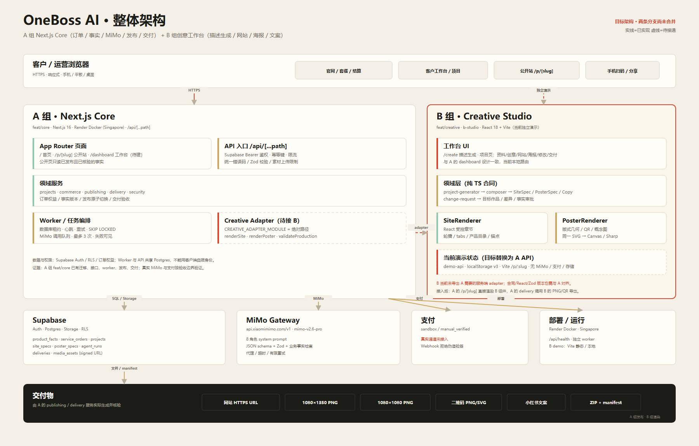
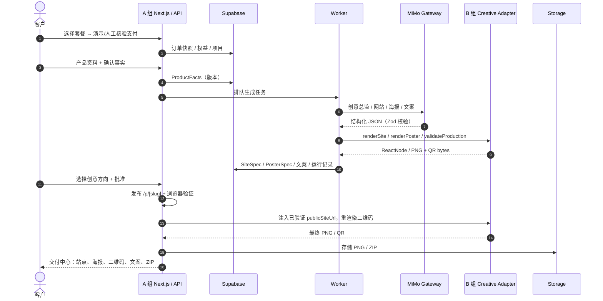

# OneBoss AI 整体架构



> 目标架构：A 组 Core（Next.js / Supabase / MiMo / 发布 / 交付）+ B 组 Creative Studio（描述生成 / 网站 / 海报 / 文案）。
> 当前仓库有两条尚未合并的分支：`feat/core`（A 组）与 `feat/creative`（B 组，`b-studio/`）。本图用实线表示已实现，虚线表示待接通。

## 1. 客户视角

```text
客户浏览器
  ├─ 官网 / 套餐 / 结算          → A 组 Next.js 页面 + /api/commerce/*
  ├─ 客户工作台 / 项目           → A 组 dashboard + B 组创意页面
  ├─ 公开宣传站 /p/[slug]        → A 组发布路由 + B 组 SiteRenderer
  └─ 手机扫码 / 分享             → 正式 HTTPS 链接
```

客户购买的是「宣传制作服务」：A 组负责订单、支付核验、产品事实、MiMo 调度、发布、存储与交付；B 组负责创意方向、网站渲染、海报/二维码、文案与客户修改体验。

## 2. 容器级架构

| 容器 | 所属 | 技术 | 职责 |
| --- | --- | --- | --- |
| Web 应用 | A | Next.js 16 App Router（React 19） | 官网、工作台、公开站 `/p/[slug]`、API 入口 |
| Core API | A | `/api/[...path]` + 服务层 | 鉴权、幂等、限流、报价/订单/支付、项目、事实、审批、发布、交付 |
| Worker | A | Node 进程 + Postgres 租约 | 队列任务、MiMo 调用、渲染、发布、ZIP，失败重试与恢复 |
| 数据库/存储 | A | Supabase Postgres + Storage + Auth + RLS | 事实、订单、项目、SiteSpec/PosterSpec、运行、交付、素材 |
| MiMo Gateway | A | 服务端 HTTP | 8 角色、结构化 JSON、Zod 校验、预算/重试/日志 |
| Creative Adapter | A→B | 绝对路径模块（`CREATIVE_ADAPTER_MODULE`） | `renderSite` / `renderPoster` / `validateProduction` |
| B Studio | B | React 18 + Vite + Router | `/create`、项目工作台、网站/海报预览、修改、交付演示 |
| B 领域层 | B | 纯 TS + Zod | 描述生成器、SiteSpec/PosterSpec 组合器、修改解析、合同 |
| B 渲染层 | B | React + SVG + Canvas/Sharp | 交互网站、海报、二维码、文案、ZIP |
| 部署 | A | Render Docker（Singapore）+ 独立 worker | `/api/health`、HTTPS、持久任务 |

## 3. 端到端主链路



关键约束：

1. QR 必须等网站 HTTPS 验证通过后，由 A 把 `publicSiteUrl` 注入 B 的 `renderPoster`；B 不猜域名。
2. 价格/参数来自 A 的 ProductFacts；B 不得自行改写或补写。
3. 只改网站时 PosterSpec 保持逐字段不变；事实变更必须重新审批并影响所有作品。
4. 交付 ZIP 只有网站、PNG、二维码都核验通过后才能生成；A 负责存储与验收。

## 4. 当前实现状态（重要）

| 能力 | A 组 `feat/core` | B 组 `feat/creative` | 状态 |
| --- | --- | --- | --- |
| 官网/公开站页面 | Next.js 首页 + `/p/[slug]` + API；dashboard 尚未实现 | B 独立 Vite 工作台 | **未合并**；dashboard 需接入同一 Next.js 或统一部署 |
| 订单/支付 | sandbox / manual_verified 服务端状态机 | 本地 demo-api | 演示口径，未接真实支付 |
| 产品事实 | Supabase 表 + 版本 + RLS | 本地 fixtures / 生成器 | 需改为 A API |
| MiMo | 真实 Gateway + 8 角色 | 本地确定性生成器 | 需把 B 生成策略接入 MiMo 输出 |
| 网站渲染 | 通过 Adapter 调 B | SiteRenderer 已实现 | `CREATIVE_ADAPTER_MODULE` 未提供，A 会返回 503 |
| 海报渲染 | 调 B 的 `renderPoster` 返回字节 | SVG/PNG 已实现（浏览器 + Node） | **缺服务端 adapter 导出** |
| 发布 | `/p/[slug]` + 原子切换 + 验证 | 演示 `/p/:slug` + localStorage | 需接 A 发布服务 |
| 交付 ZIP | JSZip + sharp + jsQR 核验 | 浏览器 ZIP 演示 | 需 B 提供字节给 A |
| 合同 | `src/contracts/index.ts`（Zod 4 / React 19） | `src/types/contracts.ts`（Zod 3 / React 18） | **版本与字段需对齐** |

### 已知集成缺口

1. **B 尚未导出 A 需要的服务端 adapter**：`renderSite` / `renderPoster` / `validateProduction`。A 的 `creative()` 在未配置 `CREATIVE_ADAPTER_MODULE` 时抛 `B_RENDERER_NOT_CONNECTED`（503）。
2. **合同差异**：A 的章节枚举为 `hero/gallery/features/specs/product-grid/brand/story/contact`，B 当前为 `hero/gallery/features/specs/products/story/cta`；A 使用 Zod 4 + React 19，B 使用 Zod 3 + React 18。
3. **B 仍是独立 SPA**：项目与发布状态在 localStorage，未使用 A 的 Supabase Auth / HTTP API；跨设备无法复现公开链接。
4. **PNG/QR 交付路径**：A 期望服务端直接返回 `Uint8Array` 并对最终 PNG 做 sharp + jsQR 核验；B 当前演示主要是浏览器 Canvas 下载。
5. **发布与二维码顺序**：B 必须在拿到 A 验证过的正式 URL 后重新渲染二维码，不能使用演示地址。

## 5. 目标集成步骤

1. **冻结共享合同**：以 A 的 `src/contracts/index.ts` 为唯一类型源，B 做适配层；统一 React/Zod 版本，或在 B 侧保持独立构建并用 DTO 映射。
2. **实现 B 服务端 adapter**：
   ```ts
   // b-studio/src/server/adapter.ts
   export async function renderSite({ site, design, facts, assets, pageSlug }) { ... }
   export async function renderPoster({ poster, design, facts, assets, publicSiteUrl }) {
     return { pngBytes, qrBytes };
   }
   export async function validateProduction({ production, facts, assets }) { ... }
   ```
   构建为 Node 可加载模块，A 配置 `CREATIVE_ADAPTER_MODULE` 绝对路径。
3. **B 页面接入 A**：把 `b-studio` 页面挂到 A 的 dashboard 路由，或作为独立前端使用 A 的 Bearer API；移除 demo-api/localStorage 真相。
4. **发布 → 二维码闭环**：A 发布并验证 URL → 把 URL 传给 B `renderPoster` → B 生成最终 PNG/QR → A 存储、核验、ZIP。
5. **验收**：用 A 的 `/api/*` 真实订单走完整链路；B 的 34 项测试与 42 项视觉 QA 作为渲染层回归。

## 6. 安全与信任边界

- **A 独占**：模型密钥、Supabase service role、支付核验、发布权限、存储签名、数据库迁移。
- **B 不拥有**：支付状态、订单金额、事实确认、模型密钥、正式发布与交付验收。
- **输入不可信**：客户文字/图片只作为数据；合同拒绝任意 HTML/JS；模型输出必须 JSON + Zod + 业务事实检查。
- **二维码**：正式海报只能使用 A 验证过的公开 HTTPS URL；B 的演示地址不能印进交付物。

## 7. 分支与文档

| 内容 | 位置 |
| --- | --- |
| A 组 Core | `feat/core`：`src/app/api/[...path]`、`src/lib/{core,commerce,mimo,workflows,publishing,delivery,security}` |
| B 组 Studio | `feat/creative`：`b-studio/` |
| A/B 合同 | `feat/core:docs/PROJECT_CONTRACT.md` |
| B 交接 | `b-studio/docs/creative-handoff.md` |
| B 视觉 QA | `b-studio/docs/visual-qa.md` |
| B 组件架构 | `b-studio/docs/architecture.md` |
| 当前 PR | https://github.com/duororschm-lgtm/oneboss-ai/pull/2 |

