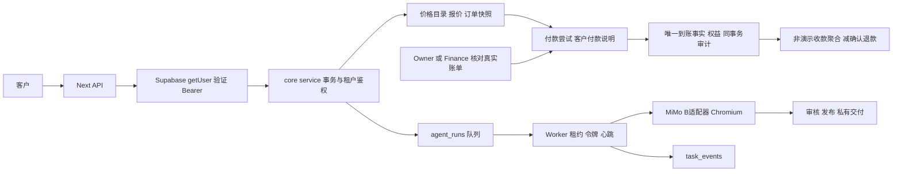

# OneBoss A 后端审计：Phase A0

日期：2026-11-08（Asia/Shanghai）。依据所有者新提供的《OneBoss_A任务书_Codex_GPT-6.1-Sol_后端核心.md》。本轮只审查业务代码、运行本地检查、写报告和契约草案，不再修改业务代码。此前实现全部保留；未提交、上传、部署或连接生产数据库。测试通过不等于全部需求完成。

## 工作保护

- 原目录 `../oneboss-ai`：分支 `feat/ai-interactive-web-v4`，HEAD `569944985055ebb627e1f99020555702531a6abb`。原有 `next-env.d.ts`、`src/lib/publishing/browser.ts` 及未跟踪恢复脚本、证书等未被移动、stash、还原或覆盖。
- 整改目录 `../oneboss-fullflow-fix`：分支 `fix/oneboss-fullflow`，HEAD `e28eb45`（此前旧审计文档提交），基于 V4 `5699449`。继续保留当前分支，不为适配任务书建议的分支名改写历史。
- 已执行 status、branch、log -5、diff --stat、diff --name-only、diff、diff --cached，并读取新增文件；暂存区为空。
- 截图“13个文件”为历史进度；A0开始时实际有30个已跟踪文件改动（+479/-220，未含新增文件），完整清单见文末。
- 历史审计提交 e28eb45 在“先不上传”要求前已推送；其后实现均为本地未提交。此次没有推送。已有前端修复保留，由 B 后续复核，不在本轮继续调整 B 组件。

## 架构与真实调用链

已阅读 AGENTS.md、README.md、package.json、RUNBOOK、PROJECT_CONTRACT、PROJECT_COMPLETION、未完成事项和旧审计。README/旧完成矩阵里的 Render 地址及 SHA 已滞后，不能当当前部署证据。

Next 16.4.5 / React 19 / TypeScript，PostgreSQL（postgres.js），Supabase Auth/私有 Storage，MiMo 网关，现有 B 创意适配器和 Chromium。



核心入口：`src/app/api/[...path]/route.ts`、`src/app/api/admin/[...path]/route.ts` → `core/service.ts`、`core/workspace.ts`、`admin/server.ts`。Worker：`scripts/worker.ts` → `workflows/runner.ts` → `mimo/gateway.ts`、`publishing/service.ts`、`delivery/service.ts`。

## 已实现与真实缺口

| 模块 | 当前代码与证据 | 未完成/限制 |
|---|---|---|
| 人工支付 | 订单/尝试保存 wechat/alipay；未配置渠道 checkout 返回503；客户说明不发权益；管理员服务端能力检查；新事件不能重复到账；事务和唯一索引 | 缺付款报告驳回/重提接口；收款码只验文件存在，不验空文件/有效图片；旧 Native 支付入口仍受旧配置控制，须落实纯人工模式硬门禁 |
| 报价 | 服务端目录、整数分、订单/明细冻结快照；价格已获既有授权 | qty=0仍被API/service拒绝，前端目前过滤0项，与新任务书0—10有差异；需补字段级错误和快照版本/时间说明 |
| 财务 | 唯一订单口径、confirmed_at、北京时间完整日期桶、范围限制、未知旧时间不伪造、成本null | rejected_at缺失；无独立分页资金流水；趋势仍数组，无元数据/区间合计；部分总览计数含演示或未提交报告订单，须统一口径 |
| AI任务 | employee_key持久化；generate/change为复合production_team；阶段事件；workspace返回最近事件 | 缺单run、事件游标、活动任务、员工列表专用接口；无progress字段，不能解释为0；阶段细分不足；无统一终态转换约束；等待/取消接口未实现 |
| Worker | 5分钟租约、30秒续租、最多3次、旧令牌隔离；独立15秒心跳、45秒离线；交付有租约保护 | 未返回队列深度/最早排队/最后成功错误；版本未注入则local-unknown；进程监督未核实；尚缺两个Worker同时领取专项测试 |
| 权限审计 | 既有管理员默认owner；finance/operations/reviewer；收款退款与审计同事务；requestId；审计失败回滚测试通过 | 视图和审批内容需进一步最小权限评估；审批、发布等审计尚未覆盖；没有公开角色变更接口，也未自动新增授权 |
| 云端连接 | Auth、Storage、MiMo、浏览器路径存在 | 本轮未调用真实MiMo或验证生产Auth/Storage/Worker/SHA；集成中的外部服务替身不能称云端连接成功 |

## 已确认根因

1. 支付竖排：customer.css 通用 input 宽度覆盖单选框；原 checkout 只展示微信。此前本地修复通过四宽度公开页面检查。
2. 数字删不掉：输入立即 Number('') 并回填0。现有字符串状态保留空白，仅报价提交解释为0。
3. 重复收入风险：旧 confirmPayment 接受 PAID/已确认attempt的新eventId，旧财务按事件行累加订单金额。现已拒绝重复并加唯一约束。源码风险不代表生产实际发生过重复。
4. 退款日期错误：旧统计使用申请时间created_at，新confirmed_at区分实际确认，不回填猜测时间。
5. 员工卡片不一致：展示key与design/generate任务类型直接比较；新增稳定employee_key，复合任务仍只有一个run。
6. 审计遗漏：旧recordAudit捕获错误返回false，调用者忽略；现同事务写审计，失败回滚。

主要影响文件：core/service.ts、core/audit.ts、core/workspace.ts、admin/server.ts、两组API route.ts、workflows/runner.ts、scripts/worker.ts、四个新迁移；前端已有修复文件见清单。

## 价格来源与已有授权

价格来源是 service_plans/service_addons → createQuote → service_orders.plan_snapshot/service_order_items。历史报价和订单保留快照。

| 项目 | 原目录 | 所有者本会话已确认 | 当前本地 |
|---|---|---|---|
| 基础版 | 199分 | ¥1.99 | 保留 |
| 专业版 | 599分 | ¥5.99 | 保留 |
| 加产品 | 9900分测试价 | ¥0.99 | 新迁移99分 |
| 加海报 | 9900分测试价 | ¥0.99 | 新迁移99分 |
| 加修改 | 4900分测试价 | ¥0.49 | 新迁移49分 |

新任务书把截图价格作为待确认线索，但当前会话已有明确授权，无需重复询价。本轮未改价格，生产未执行上述迁移。

## 数据库影响

基线6个迁移，新增4个，共10个；生产均未执行：

- `202611080002_manual_channels_and_addons.sql`：新加购价格、渠道字段、已知历史微信回填、一订单唯一到账索引；若历史重复，报错中止，不删资金事实。
- `202611080003_refund_confirmation_time.sql`：可空confirmed_at及索引；历史确认时间未知保持NULL。
- `202611080004_task_observability.sql`：任务归属/阶段/worker_id、task_events、worker_instances；启RLS并撤销客户端权限，通过可信API鉴权读取。事件拒绝直接更新/删除，但父记录级联可删，历史保留策略还须明确。
- `202611080005_admin_roles_and_audit.sql`：既有管理员默认owner、审计request_id/target_id；不授权新用户。

迁移器使用事务、advisory lock、oneboss_migrations名称和哈希账本。一次性本地库 `oneboss_fullflow_p34b_20261108` 的10条账本与当前迁移文件哈希一致。生产账本、重复事实、历史渠道来源未核实，新增约束可能被历史冲突阻塞。先只读核对，所有者批准后再迁移；不清数据、不修改已应用迁移。

回滚方向：保留新增兼容列与历史事实，回退兼容应用；不能删除资金事实、账本或业务表。最终部署顺序和补偿脚本留后续阶段交付。

## 环境与安全边界

隔离worktree无.env.local，未复制生产凭据。原目录.env.local存在数据库、Auth、公钥/服务端密钥、MiMo、APP_URL、Storage及适配器非空配置；BROWSER_EXECUTABLE_PATH未配置。仅检查是否存在，不输出值，也不等于连接通过。

仓库环境决策指DevBox `https://cwforsetsryx.sealoshzh.site` 为目标，Render为历史环境。当前实际SHA、生产账本、旧新Worker是否同时运行均未核实；域名不同不能证明数据库/Storage隔离。此次未调用生产配置，未暂停服务。

Auth调用Supabase getUser，不接受自报身份；远端Postgres验证TLS证书；Storage使用服务端密钥、私有桶和300秒签名，API签名前检查归属。MiMo只允许既有官方端点，90/180秒超时，区分HTTP/网络/超时/schema错误，日志不打印完整请求。真实连接仍需后续安全验收，健康检查不能自动消耗Token。

## 实测结果

| 检查 | 结果与边界 |
|---|---|
| 本轮 npm run typecheck | 通过 |
| 本轮 npm test | 20文件，175项通过 |
| 本轮 npm run build | 通过，包含当前全部本地改动 |
| 同代码上一轮 npm run test:integration | 独立本地库40/40；含不同eventId并发、未到账无权益、租户隔离、角色、审计失败回滚、退款跨日、事件追加和Worker过期；外部服务有替身 |
| 上一轮公开checkout浏览器 | 375/768/1280/1440：清空失焦、重输、单选17px、无横向溢出；证据.cache/fullflow-ui/results.json及截图；仅fixture，非真实资金/后台全流程 |
| 本地迁移账本只读核对 | 10条、哈希全部匹配 |

原目录176项与当前175项不代表删测试：原目录有未跟踪publishing-browser测试，当前干净V4增加addon-input单测。不得混用计数。

仍缺：0值/空收款码/付款拒绝、分页流水、事件游标、等待/取消、Worker并发领取、真实Auth/Storage/Chromium连接、B最新UI及全链路、生产验收。测试通过不替代上述证据。

## B接入与A1前确认

契约草案：[ONEBOSS_UI_API_CONTRACT.md](../contracts/ONEBOSS_UI_API_CONTRACT.md)。B可基于同一本地代码对接已实现的订单/报价、人工说明、财务数组、workspace、管理员runs/workers；不可按拟议字段造接口。本轮未给B发外部消息，也未上传代码。

按新任务书第14节，先交审计和草案，等待确认进入A1。A1建议优先：纯人工硬门禁、二维码有效性/访问边界、0—10报价语义、付款说明驳回，再完善财务和任务API。支付宝真实码尚缺；实际资金仍由所有者核对；生产迁移与部署另行批准。

## A0开始时未提交文件

已跟踪30项：

```text
.env.example
docs/setup-supabase.sql
scripts/worker.ts
src/app/(customer)/customer.css
src/app/admin/(console)/agents/page.tsx
src/app/admin/(console)/approvals/page.tsx
src/app/admin/(console)/finance/page.tsx
src/app/admin/(console)/page.tsx
src/app/api/[...path]/route.ts
src/app/api/admin/[...path]/route.ts
src/components/admin/chart.tsx
src/components/admin/shell.tsx
src/components/customer/checkout.tsx
src/components/customer/dashboard.tsx
src/components/customer/manual-payment.tsx
src/components/customer/payment-methods.ts
src/components/customer/studio.tsx
src/lib/admin/api.ts
src/lib/admin/format.ts
src/lib/admin/permissions.ts
src/lib/admin/server.ts
src/lib/admin/types.ts
src/lib/commerce/manual-payment.ts
src/lib/core/audit.ts
src/lib/core/db.ts
src/lib/core/service.ts
src/lib/core/workspace.ts
src/lib/customer/types.ts
src/lib/workflows/runner.ts
tests/integration/core.test.ts
```

新增未跟踪：.planning/、customer/use-task-polling.ts、lib/customer/addon-input.ts、上述4个迁移、tests/unit/addon-input.test.ts。本轮另新增本审计与接口契约，未覆盖上述成果。
